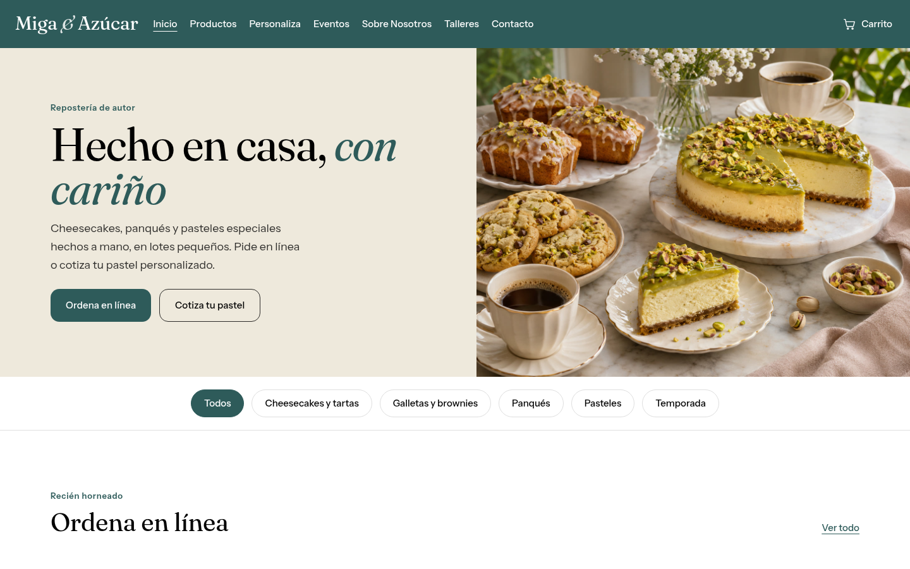
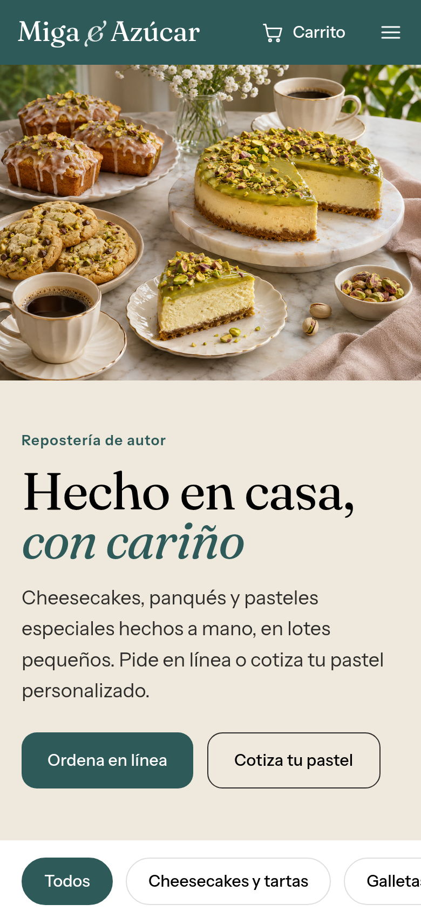

# Miga & Azúcar

Sitio web completo para una repostería de autor, con design system propio. **Proyecto concepto: la marca es ficticia.** El nombre, los textos y los datos de contacto son de ejemplo, y las fotos de producto se generaron con IA.

<p align="center">
  
  &nbsp;
  
</p>

## Qué incluye

- **10 páginas:** inicio, catálogo con filtros, ficha de producto, personaliza, eventos, talleres, sobre nosotros, preguntas frecuentes, contacto y política de privacidad.
- **Carrito** compartido entre páginas (se guarda en el navegador), con sabores, cantidades y subtotal.
- **Formularios de cotización** con validación. En la versión concepto muestran una vista previa del mensaje de WhatsApp en lugar de enviarlo.
- **Diseño para celular primero:** menú y paneles con animación, productos en dos columnas, botones de 44 px o más.
- **Accesibilidad:** contraste revisado, navegación con teclado, foco visible y respeto a «reducir movimiento».
- **Design system:** tokens de color, tipografía (Fraunces + Instrument Sans), espaciado, radios y componentes.
- **Sin dependencias** ni paso de compilación: HTML, CSS y JavaScript.

## Verlo en tu computadora

```bash
python3 -m http.server 8766
```

Luego abre http://localhost:8766.

## Estructura

```
├── index.html, productos.html, producto.html, …   páginas
├── css/
│   ├── tokens.css     design system (colores, fuentes, espaciado, radios)
│   └── styles.css     estilos y componentes
├── js/
│   ├── data.js        catálogo de ejemplo
│   └── main.js        encabezado, pie, menú, carrito e interacciones
├── assets/
│   ├── fonts/         Fraunces e Instrument Sans (licencia OFL, incluida)
│   └── img/           fotos generadas con IA
└── docs/              capturas para este README
```

Para agregar un producto, edita `js/data.js`. El encabezado, el pie y el carrito se dibujan desde `js/main.js`, así que cada página solo contiene su propio contenido.

## Créditos

- Diseño y desarrollo: [Leonardo Flores](https://github.com/SandwichMr).
- Tipografías: [Fraunces](https://github.com/undercasetype/Fraunces) e [Instrument Sans](https://github.com/Instrument/instrument-sans), bajo la SIL Open Font License (ver `assets/fonts/`).
- Fotografías: generadas con IA para este proyecto.
